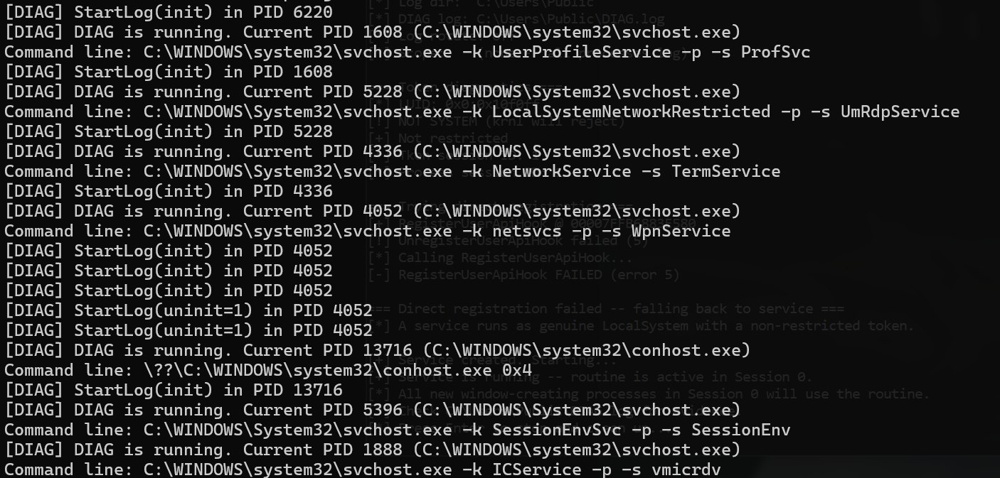

# UxDiag

Research PoC demonstrating `RegisterUserApiHook` — an undocumented export of
`user32.dll` — disguised as a harmless diagnostic logging tool.

## How it works

`win32kfull!_RegisterUserApiHook` registers a user-mode routine that win32k
invokes for every new window-creating process in the session. The call
succeeds only when, in order:

1. no hook is registered yet (`IsInsideUserApiHook`)
2. the thread token is not restricted (`SeTokenIsRestricted`)
3. the process identity is `NT AUTHORITY\SYSTEM` (LUID 0x3e7)
4. `SeTcbPrivilege` is enabled

Any failure returns `ERROR_ACCESS_DENIED`.

Once registered, `diag.dll` gets injected into each new GUI process in Session 0;
its entry point logs the PID and command line to a configurable log file.
Combined with the `logrotate` option this can be used to move arbitrary
files — helpful for evaluating the tamper-protect logic of individual
security products.

## Components

| File | Purpose |
|---|---|
| `diag.cpp`, `diag.def`, `diag.rc` | Hook DLL: logs PID + command line on every injection; supports log rotation and scope filtering |
| `uxdiag.cpp`, `uxdiag.rc` | Driver: prints identity diagnostics, registers the hook directly; falls back to a temporary SYSTEM service (`UxDiagSvc`) if direct registration fails |
| `scope_test.cpp`, `scope_test.rc` | Test suite for the scope feature: unit tests for `scope.h` plus integration tests that load the real `diag.dll` and call its exported `StartLog`. No privileges required. |
| `scope.h` | Shared "scope" logic (comma-separated image-name filter) |
| `diag.conf` | Runtime configuration, must sit next to the hook DLL |

## Configuration (`diag.conf`)

One `key=value` per line; blank lines and `#` comments are ignored.
Missing file or keys fall back to built-in defaults.

- `logdir` — log directory (default `C:\Users\Public`)
- `logname` — log file name (default `DIAG.log`)
- `logrotate` — `1` = rename the current log to `rotate-NNNNN.<ext>` on each load
- `scope` — optional comma-separated list of image file names; only matching
  processes may create/rotate/append the log, all others are ignored silently.
  Matching is case-insensitive, any path in an entry is stripped, no wildcards.
  Empty or omitted = no restriction.

## Building

Windows with Visual Studio 2022 (Build Tools) installed:

```bat
build.bat
```

Produces `diag.dll`, `uxdiag.exe` and `scope_test.exe` in the project directory.

## Usage

From an elevated Admin/SYSTEM shell:

1. `uxdiag.exe [path\to\diag.dll]` — registers the hook (directly, or via the
   service fallback)
2. Wait as long as you want and observe the log as new entries get added (optionally
you can also manually/programmatically invoke new processes as SYSTEM in Session 0
to test if they get injected into)
3. Press Enter to unregister and exit



## Notes

- The registered routine is per-session; it is unregistered on exit / service stop.
- Research PoC only — use at your own risk.

Author: Julian Horoszkiewicz (Atos Threat Research Center)
